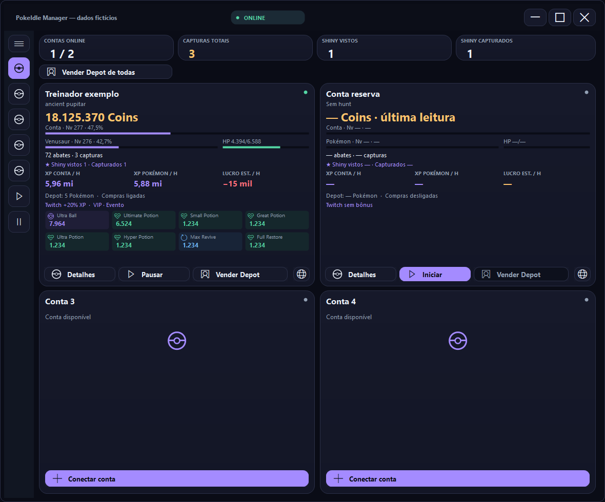
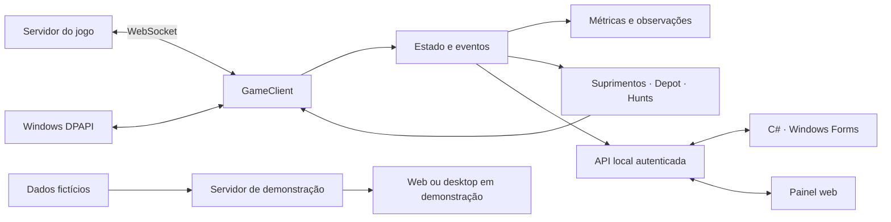

<div align="center">

# PokeIdle Manager

**Um aplicativo desktop para acompanhar múltiplas contas, transformar eventos em métricas e controlar operações com confirmação.**

[](https://github.com/duduescudero/pokeidle-manager/actions/workflows/quality.yml)


[Experimentar](#experimente-sem-uma-conta) · [Decisões técnicas](#decisões-que-orientaram-o-projeto) · [Arquitetura](docs/arquitetura.md) · [Testes](docs/testes.md)

</div>



*Interface real em Windows Forms, renderizada com dados fictícios. Os valores e estados apresentados não são resultados medidos no jogo.*

## Por que construí este projeto

Acompanhar várias contas envolve mais do que mostrar números: é preciso lidar com conexões interrompidas, estados parciais e operações cujo resultado pode demorar a chegar. Desenvolvi este gerenciador para reunir essas informações e estudar como uma aplicação orientada a eventos pode agir sem tratar uma tentativa como sucesso.

O resultado combina um backend em Node.js, uma interface nativa em C# e testes para situações como reconexão, sessão renovada, compra sem confirmação e troca de rota durante um combate. O projeto nasceu de um uso pessoal e foi preparado para apresentação com uma demonstração independente das contas reais.

## Experimente sem uma conta

Com **Node.js 24 ou posterior** e Git instalados:

```bash
git clone https://github.com/duduescudero/pokeidle-manager.git
cd pokeidle-manager
npm run demo
```

Abra **http://127.0.0.1:3848**. Clique nos cartões para explorar os detalhes das contas. Encerre com `Ctrl+C`.

Não há dependências npm externas nem etapa de instalação. A demonstração usa um arquivo local de dados fictícios: não lê sessões, não abre WebSockets e não aceita operações de compra, venda ou importação.

No **Windows 10/11**, também é possível explorar a interface nativa:

```bash
npm run demo:desktop
```

O painel web oferece uma apresentação resumida. O painel Windows Forms permite navegar pelas telas de contas, suprimentos, Depot e hunts, com operações reais bloqueadas. Veja [como executar e encerrar](docs/uso.md).

## O que está implementado

| Área | Comportamento |
| --- | --- |
| Múltiplas contas | Até quatro sessões independentes e visão geral das contas. |
| Comunicação | WebSocket, estado completo e incremental, heartbeat e reconexão com espera progressiva. |
| Métricas | Coins, progresso de XP, capturas e indicadores por tempo de atividade. |
| Suprimentos | Reposição com estoque mínimo, reserva de Coins, orçamento e confirmação do estoque. |
| Hunts | Seleção manual enfileirada e seleção automática opcional, respeitando estado e liberação do servidor. |
| Recomendações | Estimador local de XP e risco; requer catálogo externo opcional. |
| Depot | Seleção e venda com confirmação, preservando Coleção, equipe e Exp. Share equipada. |
| Sessões | Proteção com Windows DPAPI e atualização das credenciais renovadas. |
| Navegador | Janela isolada por conta, com pausa da conexão daquela conta antes da navegação. |
| Twitch | Apresentação das informações de bônus recebidas do jogo; detecção de live não é tratada como bônus confirmado. |

Esses recursos pertencem ao modo conectado. A demonstração exibe exemplos e telas, sem executar a integração. O catálogo completo e os arquivos de pesquisa de terceiros não são distribuídos neste repositório. [Origens e limites](docs/origens.md).

## Decisões que orientaram o projeto

**Uma operação enviada ainda não é uma operação concluída.** Compras e vendas mantêm um estado pendente até receber confirmação. Quando o resultado fica incerto, o aplicativo bloqueia uma repetição automática e pede revisão. A intenção é evitar que uma reconexão cause uma segunda operação.

**Dados antigos não autorizam novas ações.** A conexão e a atualidade do estado são verificadas antes das operações. Trocas de hunt aguardam a liberação do combate e têm prazo de confirmação.

**A sessão fica no computador do usuário.** As credenciais são protegidas pelo Windows DPAPI. A API local fica vinculada ao endereço de loopback e usa uma chave aleatória por execução; as ações também verificam a origem da requisição.

**Estimativa e medição têm significados diferentes.** O estimador considera atributos, golpes e características das rotas, mas não promete o rendimento real. As observações de execução ficam separadas das previsões.

**A demonstração tem um caminho próprio.** Seu servidor não importa o cliente do jogo nem o cofre de sessões. As restrições são aplicadas no backend, além da apresentação da interface.

## Como as partes se conectam



[Leia a arquitetura e as responsabilidades dos módulos](docs/arquitetura.md).

## Validar o código

```bash
npm test
```

No Windows, para compilar a interface e verificar fluxos e layouts com dados fictícios:

```bash
npm run test:desktop
```

O GitHub Actions executa os testes Node.js em Linux e Windows e a verificação da interface no Windows. Um teste de comparação com um guia externo é opcional e aparece como ignorado quando o catálogo local não está instalado. [Escopo e limites dos testes](docs/testes.md).

## Estrutura

```text
src/       cliente, estado, métricas, operações e demonstração
desktop/   componentes e telas Windows Forms
scripts/   cofre, inicialização e manutenção
public/    painel web e apresentação da demonstração
test/      testes automatizados e dados fictícios
docs/      arquitetura, execução, testes e imagens
data/      orientação para o catálogo externo opcional
```

## Limites e próximos passos

A interface nativa e o cofre dependem do Windows. A integração conectada depende do protocolo e dos dados do jogo e pode precisar de ajustes quando ele mudar. Os testes simulados não comprovam a disponibilidade atual do servidor nem o funcionamento de cada operação em contas reais.

A distribuição inicial contém código-fonte. Não há instalador ou executável publicado. Melhorias de interface, atualização de catálogo e distribuição estão descritas no [roadmap](docs/roadmap.md).

## Desenvolvimento

Projeto pessoal de **Eduardo Escudero**, estudante de Engenharia de Software. Desenvolvido com apoio de IA na implementação e revisão; a documentação apresenta o funcionamento verificável do código e suas limitações.

[GitHub · duduescudero](https://github.com/duduescudero)

Este projeto é independente, sem vínculo oficial com PokeIdle ou com os titulares de Pokémon. Os nomes citados identificam a integração estudada; recursos gráficos e bundles do jogo não fazem parte da distribuição.
