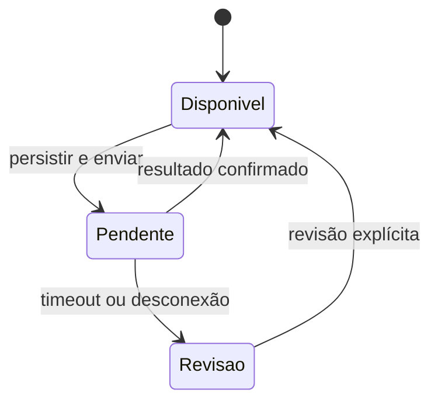

# Arquitetura

`src/main.mjs` compõe os módulos, persiste preferências e mantém a API em `127.0.0.1:3847`. A chave é aleatória por execução; o desktop a recebe por variável de ambiente e a remove do próprio ambiente após a leitura. O painel web recebe a chave no HTML local.

| Módulo | Responsabilidade |
| --- | --- |
| `client.mjs` | WebSocket, autenticação, heartbeat, reconexão e confirmação de trocas de hunt. |
| `state.mjs` | Aplicar snapshots completos e deltas. |
| `metrics.mjs` | Derivar indicadores de eventos confirmados e tempo de atividade. |
| `replenish.mjs` | Validar estoque, reserva e orçamento; persistir pendências antes de enviar compras. |
| `depot.mjs` | Selecionar itens elegíveis, confirmar vendas e bloquear repetição de resultados incertos. |
| `hunt-advisor.mjs` | Estimar XP e risco com catálogo local opcional. |
| `hunt-observations.mjs` | Separar observações de execução das estimativas. |
| `auto-hunt.mjs` | Seleção opcional com ganho mínimo, intervalo e verificações de estado. |
| `account-browser.mjs` | Abrir contexto isolado, pausar a conta e acompanhar renovação da sessão. |
| `twitch.mjs`, `twitch-view.mjs` | Elegibilidade e bônus informado pelo servidor, com páginas locais limitadas. |
| `scripts/vault.ps1` | Proteger sessões com DPAPI no contexto do usuário Windows. |

As preferências e sessões desta versão ficam em `%LOCALAPPDATA%\PokeidleManager`, separadas da pasta do aplicativo original. Não há importação automática de contas.

## Interface nativa

Windows PowerShell 5.1 compila os arquivos C# de `desktop/` com `Add-Type`, usando .NET Framework e Windows Forms, sem NuGet ou SDK adicional.

- `theme.cs`: paleta, tipografia, leitura dos dados e componentes comuns.
- `desktop-controls.cs`: janela, bandeja, redimensionamento e controles de base.
- `fleet-card.cs`, `dashboard.cs`: cartões e navegação principal.
- `supply-form.cs`, `depot-form.cs`, `hunt-form.cs`: telas e eventos de cada área.
- `desktop.ps1`: composição, chamadas à API, atualização e validação com fixtures.
- `desktop-launcher.cs`: iniciador auxiliar; o comando documentado é `npm start`.

A divisão em arquivos preserva as classes e contratos existentes. Não foi uma reescrita da aplicação.

## Demonstração

`src/demo.mjs` inicia `demo-server.mjs` em `127.0.0.1:3848`. O servidor lê somente HTML e o fixture local, oferece leitura de estado autenticada e rejeita métodos diferentes de GET. Não importa `main.mjs`, não lê o cofre e não abre conexões externas.

O painel web usa `public/demo.html`. A interface Windows recebe `-Demo`, usa a porta 3848 e bloqueia alterações também no adaptador PowerShell. Fechar o painel encerra o servidor iniciado por `demo:desktop`.

## Estado incerto

O diagrama resume as proteções de compras e vendas. Autorização, limites e atualidade do estado são verificações adicionais. Não existe transação distribuída com o servidor externo; um resultado incerto precisa ser tratado explicitamente.
